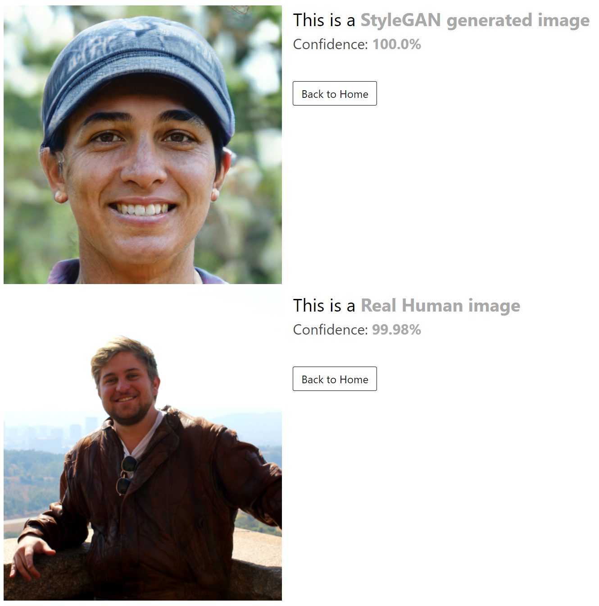

<div align="center">

# Identifying StyleGAN Images

**Detecting StyleGAN-generated faces with a hyperparameter-optimised convolutional neural network**

BSc Honours research project · Computer Science and Information Technology · North-West University · 2021

[](https://github.com/neilfoxcroft/identifying-stylegan-images/releases/latest/download/Identifying-StyleGAN-Images-Neil-Foxcroft-2021.pdf)
[](https://www.youtube.com/watch?v=MzG4RjvZbuo)
[](thesis/Documentation_inProgress/Main.pdf)


</div>

---

## Overview

[StyleGAN](https://github.com/NVlabs/stylegan) can generate photorealistic faces of people who do not exist, like those on *ThisPersonDoesNotExist.com*. These faces routinely pass human visual inspection, which makes them useful to fraudsters building false identities.

This project investigates whether a **convolutional neural network (CNN)** can reliably tell StyleGAN faces apart from real photographs. A CNN is trained on real faces from NVIDIA's FlickrFaces (FFHQ) dataset and StyleGAN-generated faces, then tuned with the **[Optuna](https://optuna.org/)** hyperparameter-optimisation framework. The final model is served through a **Flask** web app: upload a face and it tells you whether it is *a StyleGAN generated image* or *a real human image*, along with its confidence.

## Results

Hyperparameter optimisation took the model from a proof of concept to **97.6% tested accuracy**, on modest hardware (a GTX 1080 and Google Colab).

| Model | Tested accuracy | Average confidence |
|---|---:|---:|
| Baseline CNN (cat-vs-dog architecture, retrained) | 61.0% | 57.0% |
| Hot-and-cold learning | 69.0% | 65.4% |
| **Optuna hyperparameter-optimised CNN** | **97.6%** | **97.0%** |

<p align="center">
  
  <br><sub>The final model in the web app, classifying a StyleGAN face and a real face it had never seen.</sub>
</p>

The thesis also discusses the model's limits. It was trained on StyleGAN (v1) images and is less accurate on StyleGAN2 faces, and the thesis suggests training on a mixed StyleGAN 1/2/3 dataset as future work. Chapter 4 has the full evaluation.

## Video walkthrough

<a href="https://www.youtube.com/watch?v=MzG4RjvZbuo">
  
</a>

A 12-minute presentation of the research and a live demo of the web app.

## Repository structure

```
identifying-stylegan-images/
├── thesis/                         # The honours thesis (LaTeX)
│   ├── Documentation_inProgress/   # Final thesis source and compiled PDF
│   │   ├── Main.tex / Main.pdf     #   entry point and final 97-page PDF
│   │   ├── chapters/               #   1 Intro · 2 Literature · 3 Artefact · 4 Results · 5 Reflection
│   │   ├── appendix/               #   ethics, research proposal, training notebooks (PDF)
│   │   ├── img/                    #   figures
│   │   ├── MyBib.bib               #   bibliography
│   │   └── NWUStyle.sty            #   NWU thesis style
│   └── Document_check/             # Earlier draft submitted for review
└── webapp/                         # Flask web app that serves the trained model
    ├── app.py                      # Image upload, preprocessing and prediction
    ├── templates/                  # Home, result and error pages
    └── static/
        └── models/placeholderm.h5  # Trained Optuna-optimised CNN (Keras)
```

## How it works

1. **Preprocess:** the uploaded image is decoded, resized to 200×200 px and normalised to [0, 1].
2. **Classify:** the Keras CNN (three Conv2D → MaxPool → Dropout blocks with 16, 32 and 64 filters, then a sigmoid output) returns a probability.
3. **Report:** a probability of 0.5 or higher means *StyleGAN generated image*, otherwise *Real Human image*. The confidence is shown as a percentage.

> The file is named `placeholderm.h5`, but it is the final trained model described in the thesis.

## Running the web app

Requires Python 3.7+ (the app was built against TensorFlow 2.6).

```bash
git clone https://github.com/neilfoxcroft/identifying-stylegan-images.git
cd identifying-stylegan-images/webapp

python -m venv .venv
source .venv/bin/activate        # Windows: .venv\Scripts\activate
pip install -r requirements.txt

mkdir uploads                    # where uploaded images are stored
python app.py
```

Open <http://127.0.0.1:5000>, upload a face image, and the app returns its prediction.

## The thesis

**Identifying StyleGAN images**: Neil Foxcroft, BSc Honours in Computer Science and Information Technology, North-West University (2021). Supervisor: Dr R. Serfontein.

- 📄 **[Download the PDF](https://github.com/neilfoxcroft/identifying-stylegan-images/releases/latest/download/Identifying-StyleGAN-Images-Neil-Foxcroft-2021.pdf)** (from the latest release)
- 👀 **[Read it on GitHub](thesis/Documentation_inProgress/Main.pdf)**
- 🛠️ **Build from source:** compile `thesis/Documentation_inProgress/Main.tex` with `pdflatex` → `bibtex` → `pdflatex` ×2

The Google Colab training notebooks (including the Optuna study) are included as PDF printouts in [`thesis/Documentation_inProgress/appendix/`](thesis/Documentation_inProgress/appendix) (`nb1.pdf`, `nb2.pdf`).

## History

This repository brings together two earlier repositories, with their full commit history preserved:

- [`StyleGAN-Identification`](https://github.com/neilfoxcroft/StyleGAN-Identification) → `thesis/`
- [`StyleGAN_identification_WebAPP`](https://github.com/neilfoxcroft/StyleGAN_identification_WebAPP) → `webapp/`

Both originals are archived and still available read-only.

## Acknowledgements

Thanks to Dr Rudi Serfontein for supervising the project, to Prof Tiny du Toit for sharing his knowledge of AI and the GPU used to train part of the model, and to Manré van Zyl and Affaan Muhammad for their collaboration and input throughout the year.

## Citation

```bibtex
@thesis{foxcroft2021stylegan,
  author      = {Foxcroft, Neil},
  title       = {Identifying StyleGAN images},
  type        = {BSc Honours research project},
  institution = {North-West University},
  year        = {2021},
  url         = {https://github.com/neilfoxcroft/identifying-stylegan-images}
}
```

---

<div align="center">
<sub><a href="https://neilfoxcroft.com">neilfoxcroft.com</a> · <a href="https://orcid.org/0000-0002-8389-8826">ORCID 0000-0002-8389-8826</a></sub>
</div>
